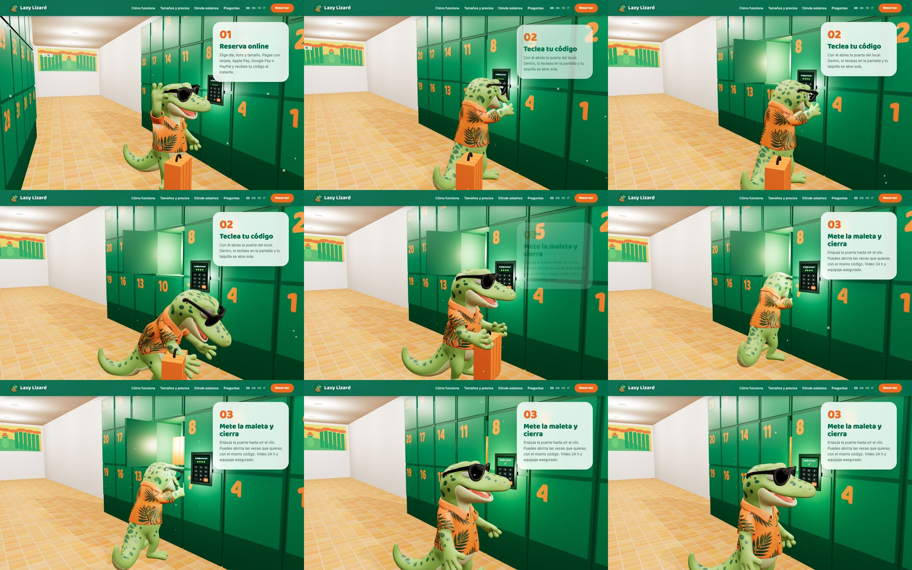

# Lazy Lizard · el lagarto en 3D

La mascota del logo de **Lazy Lizard** (consigna de equipaje 24 h en Poble Sec, Barcelona), modelada y animada en 3D para web y app.



## El modelo

`modelo/lagarto.glb` (1,8 MB, glTF binario, texturas WebP). Esqueleto de **60 huesos** y **7 animaciones** (24 fps):

| Clip | Qué hace | Duración |
|---|---|---|
| `Idle` | Respira, cambia el peso de pie, mira alrededor, la cola se mece (bucle) | 3,2 s |
| `Saludo` | Levanta el brazo, agita la mano con los dedos abiertos, la boca habla | 2,0 s |
| `Teclear` | Teclea un código con el índice, cuatro toques, mira la taquilla | 2,4 s |
| `Coger` | Se agacha doblando rodillas, cierra los puños sobre el asa y se incorpora | 2,4 s |
| `Guardar` | Da dos pasos, levanta la maleta, la empuja dentro y suelta | 2,6 s |
| `Cerrar` | Empuja la puerta con la palma hasta que encaja y asiente | 1,6 s |
| `Adios` | Pulgar arriba con una mano, saludo con la otra, reverencia | 2,2 s |

Huesos añadidos al rig automático: cola (`Cola01`–`Cola05`), `Mandibula`, `Gafas` (hacen de cejas) y dos por dedo (`R_Dedo1_1` … `L_Dedo3_2`). Los pies están clavados al suelo en todos los fotogramas (comprobado: mínimo de la malla ≥ −3 mm). Origen en los pies, en y = 0; mide 1 unidad de alto.

## Usarlo por URL

```
https://raw.githubusercontent.com/Esparramador/lazy-lizard-3d/main/modelo/lagarto.glb
```

### three.js
```js
import { GLTFLoader } from "three/addons/loaders/GLTFLoader.js";
const URL = "https://raw.githubusercontent.com/Esparramador/lazy-lizard-3d/main/modelo/lagarto.glb";
const gltf = await new GLTFLoader().loadAsync(URL);
const lagarto = gltf.scene; lagarto.scale.setScalar(1.25);           // 1,25 m de alto
const mixer = new THREE.AnimationMixer(lagarto);
const clips = Object.fromEntries(gltf.animations.map(c => [c.name, mixer.clipAction(c)]));
clips.Saludo.play();                                                  // mixer.update(dt) en cada fotograma
```
El modelo mira hacia +X: para que mire a la cámara, `lagarto.rotation.y = -Math.PI / 2`.

### Vista rápida
Arrastra `lagarto.glb` a <https://gltf-viewer.donmccurdy.com/> o a <https://modelviewer.dev/editor/>.

### `<model-viewer>` (web sin código 3D)
```html
<script type="module" src="https://ajax.googleapis.com/ajax/libs/model-viewer/3.5.0/model-viewer.min.js"></script>
<model-viewer src="https://raw.githubusercontent.com/Esparramador/lazy-lizard-3d/main/modelo/lagarto.glb"
  animation-name="Saludo" autoplay camera-controls shadow-intensity="1" style="width:360px;height:480px"></model-viewer>
```

## Cómo se hizo
1. `fuentes/logo-original.png` → lámina de cuerpo entero con IA (`fuentes/lamina-del-logo.png`).
2. Lámina → modelo 3D con texturas y esqueleto de 41 huesos (Tripo3D): `fuentes/lagarto-rig-tripo.glb`.
3. `fuentes/animar.py` (Blender 5, en segundo plano) crea la cola, la mandíbula, las gafas y los dedos, reparte los pesos leyendo la textura (lengua roja, montura negra), posa los siete clips y los exporta:

```bash
Blender --background --factory-startup --python fuentes/animar.py -- fuentes/lagarto-rig-tripo.glb modelo/lagarto.glb vistas/
```

## Aviso
El personaje es la mascota de Lazy Lizard (lazylizard.es). Marca y diseño © Lazy Lizard; el uso fuera de su proyecto requiere su permiso.
